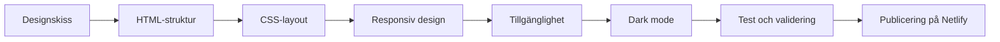

# u01-ludvig

[](#)
[](#)
[](#)
[](https://u01-ludvig-portfolio.netlify.app/)

**Live-sida:** [https://u01-ludvig-portfolio.netlify.app/](https://u01-ludvig-portfolio.netlify.app/)

https://ludvigpalacios.github.io/u01-ludvig/


En responsiv portfolio-webbplats byggd med HTML, CSS och JavaScript. Projektet är en översättning av en designskiss till kod, med fokus på layout, dark mode, tillgänglighet och anpassning för olika skärmstorlekar.



## Innehåll

- [Om projektet](#om-projektet)
- [Funktioner](#funktioner)
- [Tekniker](#tekniker)
- [Projektstruktur](#projektstruktur)
- [Responsiv design](#responsiv-design)
- [Dark mode](#dark-mode)
- [Tillgänglighet](#tillgänglighet)
- [Reflektion](#reflektion)
- [Vad jag skulle förbättra](#vad-jag-skulle-förbättra)

---

## Om projektet

Portfolio-sidan består av flera sektioner: en introduktion med profilbild, en sida med arbetsbeskrivningar och ikoner, en teknologisektion med SVG-ikoner samt en projektsida med kort som visar projekt, beskrivningar och länkar.

Jag började med att bygga upp sidans grundstruktur i HTML och skapa en mobilanpassad layout. Sedan byggde jag vidare med CSS för att få till typografi, färger, mellanrum, gradienter och responsiva brytpunkter. JavaScript används för hamburgermenyn, som gör att menyn kan visas och döljas när användaren klickar på den.

Målet var inte bara att få sidan att likna designen, utan också att göra den begriplig, tillgänglig och anpassningsbar för olika användare och skärmar.

---

## Funktioner

- Responsiv layout för mobil, surfplatta och desktop
- Hamburgermeny som kan visas och döljas med JavaScript
- Automatisk dark mode baserat på användarens systeminställning
- CSS-variabler för färger som återanvänds på flera ställen
- Gradienttext med `linear-gradient` och `background-clip: text`
- Grid-layout för teknologiikoner och projektkort
- Flexbox för navigation, introduktion, kort och footern
- SVG-ikoner med anpassad färg för light och dark mode
- Tillgänglighetsförbättringar med `aria-label` och korrekt HTML-struktur
- Publicerad på Netlify

---

## Tekniker

| Teknik | Användning |
|---|---|
| HTML5 | Sidstruktur, semantiska element, bilder, länkar och SVG |
| CSS3 | Layout, typografi, färger, gradienter, animationer och dark mode |
| Flexbox | Navigation, introduktion, kort, beskrivningar och footern |
| CSS Grid | Teknologiikoner och projektrutor |
| Media queries | Responsiva brytpunkter och dark mode |
| CSS-variabler | Återanvändbara färger för light och dark mode |
| JavaScript | Hamburgermeny och klickhändelser |
| Netlify | Publicering och live-distribution |

---

## Projektstruktur

```text
.
├── index.html
├── base.css
├── 2ndpage.css
├── 3rdpage.css
├── 4thpage.css
├── footer.css
├── base.js
└── README.md
```

- `index.html` innehåller sidans struktur, innehåll, SVG-ikoner och länkar.
- `base.css` innehåller globala variabler, grundstilar, navigation, introduktion och dark mode.
- `2ndpage.css`, `3rdpage.css` och `4thpage.css` innehåller stilar för respektive sida.
- `footer.css` innehåller stilar för footern.
- `base.js` hanterar hamburgermenyn.

---

## Responsiv design

Jag använde en kombination av Flexbox och Grid. Grid användes främst för större layouter, till exempel teknologiikoner och projektrutor, där innehållet behövde ligga i tydliga rader och kolumner. Flexbox användes för element som behövde anpassa sig mer dynamiskt, till exempel navigation, introduktion, kort och beskrivningar.

På små skärmar ligger mycket innehåll i kolumn. När skärmen blir bredare ändras layouten till rader, marginaler och storlekar justeras och vissa element visas eller döljs. Navigationens hamburgermeny är till exempel dold på större skärmar, medan menylänkarna visas i en rad.

```css
@media (min-width: 860px) {
  header {
    flex-direction: row;
    flex-wrap: nowrap;
  }

  .hamburgare div {
    display: none;
  }

  .hamburgare-meny {
    flex-direction: row;
    margin-left: auto;
  }
}
```

Brytpunkterna valde jag utifrån när layouten började se trång eller trasig ut, snarare än att bara använda standardvärden. Jag testade genom att dra i webbläsarens fönster och justerade när element började hamna fel eller bli för små.

---

## Dark mode

Dark mode aktiveras automatiskt om användarens operativsystem eller webbläsare är inställt på mörkt läge. Jag använde CSS-variabler i `:root` för att kunna byta färger centralt istället för att ändra varje element separat.

```css
:root {
  --background: #ffffff;
  --text: #1f1f1f;
  --muted-text: #5c5c5c;
}

@media (prefers-color-scheme: dark) {
  :root {
    --background: #121212;
    --text: #f1f1f1;
    --muted-text: #d6d6d6;
  }
}
```

Färgerna används sedan med `var()`:

```css
body {
  background-color: var(--background);
  color: var(--text);
}
```

För vissa enkla svartvita SVG-ikoner använde jag även `filter: invert(1)` i dark mode. Det var ett praktiskt sätt att få ikoner att byta från mörka till ljusa utan att behöva bygga om SVG-filerna.

---

## Tillgänglighet

Jag använde Lighthouse, WCAG Contrast Checker och W3C-validatorn för att testa och förbättra sidan.

Lighthouse påpekade bland annat att SVG-ikonerna behövde tillgängliga namn. Eftersom SVG inte använder `alt` på samma sätt som ``, lärde jag mig att använda `role="img"` och `aria-label`:


```html
<svg class="github" role="img" aria-label="GitHub" viewBox="0 0 24 24">
  <!-- SVG-innehåll -->
</svg>
```

Jag kontrollerade också färgkontraster med WCAG Contrast Checker och justerade flera färger så att kontrasten blev minst 4.5:1. Det gällde särskilt text, ikoner och färger i dark mode.

Den största utmaningen var W3C-validatorn. Jag började med ungefär 130 errors och fick bland annat:

- Byta ut felaktiga `<text>`-element mot `<span>`
- Fixa felaktig nestning av HTML-element
- Ersätta `alt` på SVG-element med `aria-label`
- Se till att element som `<p>` inte innehöll blockelement

Arbetet visade hur viktigt det är att skriva korrekt och semantisk HTML från början, istället för att försöka fixa allt i slutet.

---

## Reflektion

### Från skiss till kod

Det var inte så mycket i skissen som var svårt att översätta direkt till HTML och CSS. Det svåraste var att få till rätt färger jämfört med source-designen, särskilt för vanlig text och paragrafer. Vissa färger såg bra ut men hade för låg kontrast, så jag behövde ändra dem för att följa WCAG.

Gradienten var också utmanande i början. Jag fick googla och läsa för att förstå hur `linear-gradient`, `background-clip: text` och transparent textfärg fungerade tillsammans. När jag väl förstod det kunde jag återanvända tekniken på logotypen och andra textelement.

### Semantik

I början var jag osäker på vilka HTML-element jag skulle använda för de olika delarna av sidorna. Eftersom ingen av sidorna innehöll innehåll som passade i en `<aside>`, använde jag `<section>` för det mesta. Jag använde också korresponderande element där det var möjligt, till exempel `<a>` för länkar och `<header>`, `<main>` samt `<footer>` för sidans huvuddelar.

Jag lärde mig att semantiska element gör koden tydligare för både utvecklare och hjälpmedel. `<div>` använde jag när jag bara behövde en behållare för layout eller styling.

### Layout

Jag tycker att en blandning av Flexbox och Grid fungerar bäst. Jag använde mest Grid för förälderelement, särskilt på sida 3 och 4, eftersom jag ville att innehållet skulle hålla sig i rader och kolumner. Sedan använde jag Flexbox för barnen inuti griden, eftersom jag ville att de skulle kunna krympa, flytta sig eller centreras beroende på skärmens bredd.

På navigationen valde jag Flexbox eftersom den behöver anpassa sig mycket efter skärmens bredd. Jag använde media queries för att ändra flex-riktning, dölja hamburgermenyn på större skärmar och justera mellanrum och storlekar. Brytpunkterna lade jag där layouten började se trasig eller för trång ut, till exempel runt 400px, 600px och 860px.

### Tillgänglighet

Jag använde Lighthouse för att testa sidan. Där fick jag tips om att lägga till labels för mina SVG-ikoner. Eftersom SVG-element inte använder `alt` på samma sätt som ``, lärde jag mig att använda `role="img"` och `aria-label`.

Jag använde också WCAG Contrast Checker för att kolla färgkontrasten. Jag anpassade flera färger så att kontrasten blev minst 4.5:1, vilket gjorde texten tydligare och bättre anpassad för personer med nedsatt syn.

Den största utmaningen var W3C-validatorn. Jag började med ungefär 130 errors och fick ändra många `<text>`-element till `<span>`, fixa felaktig nestning och byta `alt` till `aria-label` på SVG:er. Jag lyckades bli av med de flesta felen, men det visade mig hur viktigt det är att skriva korrekt och semantisk HTML från början.

### Användbarhet

Jag känner igen flera UX- och UI-principer i Pawans design. Sidan har en tydlig hierarki med stor rubrik, kort introduktion och tydliga sektioner. Färgerna och gradienten används för att skapa visuell igenkänning, medan mycket vit yta gör att innehållet inte känns överbelastat.

Navigationen är också enkel och återanvänds på flera sidor, vilket gör det lättare att förstå var man befinner sig. Om jag hade gjort något annorlunda skulle jag kanske ha gjort navigationen ännu tydligare på mobil, till exempel med en riktig hamburgermeny som öppnar och stänger länkarna. Jag skulle också ha lagt mer fokus på konsekventa marginaler och avstånd mellan sektionerna.

---

## Vad jag skulle förbättra

- [ ] Göra hamburgermenyn mer komplett med öppnings- och stängningsfunktion
- [ ] Lägga till en knapp för att manuellt växla mellan light och dark mode
- [ ] Spara tema-val i `localStorage`
- [ ] Rensa upp och strukturera media queries
- [ ] Optimera profilbilden för bättre prestanda
- [ ] Använda konsekventa engelska klassnamn
- [ ] Lägga till fler interaktiva detaljer, till exempel hover-effekter och animationer

---

## AI-verktyg

Jag har inte använt AI särskilt mycket under projektet förutom till att snygga till denna readme, eftersom jag ogillar “vibe coding”. Jag tycker att det ofta tar mycket tid att skriva bra prompts, och när det handlar om grunderna är det bättre att skriva koden själv, testa och felsöka steg för steg.

Jag har dock använt AI som stöd för att förklara koncept, till exempel CSS-variabler, dark mode, `order` och SVG-tillgänglighet. Jag ändrade alltid det genererade svaret så att det passade min egen kod, mina erfarenheter och min skrivstil.

---

## Publicering

Webbplatsen är publicerad på Netlify:

[https://u01-ludvig-portfolio.netlify.app/](https://u01-ludvig-portfolio.netlify.app/)
